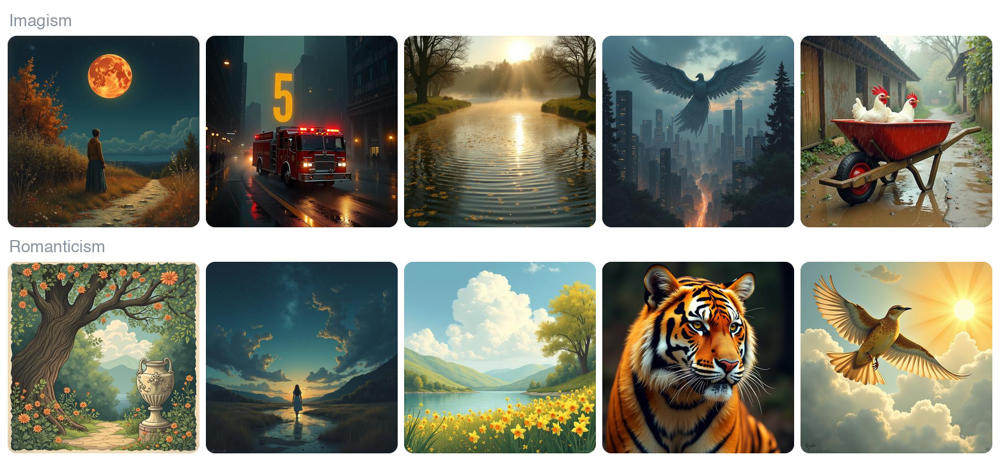

# Poetry and image variation

ENGE3940 *AI and Language* course project, CUHK, fall 2025.

Imagist poets asked for "direct treatment of the thing". If that intent survives in the words, a text-to-image model should have fewer ways to picture an Imagist poem than a Romantic one, where the scene arrives through the speaker's feelings. I tested this on ten excerpts, five from each movement. Each excerpt got 20 images from FLUX.1-dev and 20 from Stable Diffusion, run on a Colab A100, and each set of 20 got one variation score from the cosine similarity of its CLIP ViT-L embeddings.



<sub>One saved FLUX.1-dev sample per poem. It is cut from the two 5×5 sheets in `assets/`, which show five samples per poem.</sub>

## Result

Imagist excerpts produced less varied images. With FLUX.1-dev, their mean variation score was 0.122, against 0.282 for the Romantic excerpts (Student's t-test, p = 0.0499).

| | Imagism | Romanticism |
|---|---:|---:|
| Poems | 5 | 5 |
| Images per poem | 20 | 20 |
| Mean variation score | 0.122 | 0.282 |

Imagism: *The Red Wheelbarrow*, *The Great Figure*, *The City*, *Round-Pond*, *Autumn*.
Romanticism: *I Wandered Lonely as a Cloud*, *Ode on a Grecian Urn*, *To a Skylark*, *The Tyger*, *She Walks in Beauty*.

## What is here

- `data/`: one saved score per poem for each model (column `Variance`), with the exact prompt used.
- `scripts/summarize.py`: group summaries and consistency checks on the tables, standard library only.
- `scripts/compare_ttests.py`: t-tests on the poem-level scores.
- `scripts/make_banner.py`: rebuilds the banner above from the two FLUX sheets.
- `scripts/make_grid.py`: builds a contact sheet from a folder of generated images.
- `assets/archive/`: the original course plots and two diagrams cropped from the course poster.
- `reports/`: file hashes, the checks that were run, and saved output from the two analysis scripts.

Image generation and CLIP scoring ran on Colab. This repository holds the saved scores and the analysis, and nothing in it calls a model or an API.

## Run

`summarize.py` needs only Python. The other scripts and the full test suite need SciPy and Pillow.

```sh
python3 scripts/summarize.py
python3 -m venv .venv
. .venv/bin/activate
python -m pip install -r requirements.txt
python scripts/compare_ttests.py
python scripts/make_banner.py --output output/banner.png
python -m unittest discover -s tests -v
```

The scripts work from any directory.
